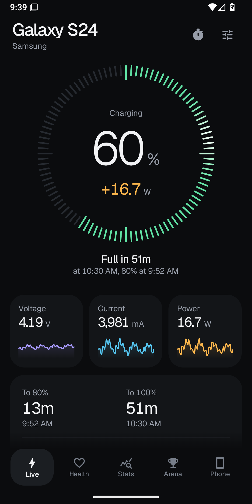
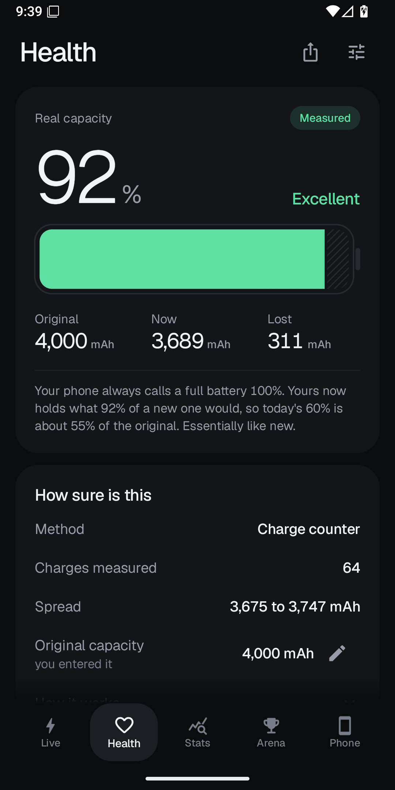
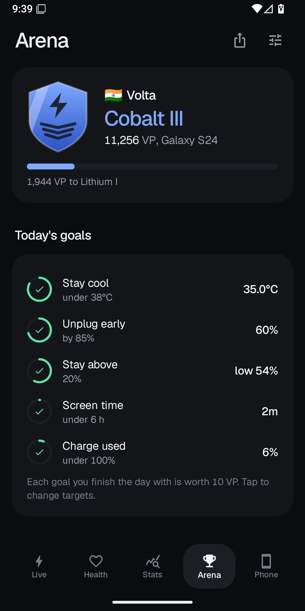
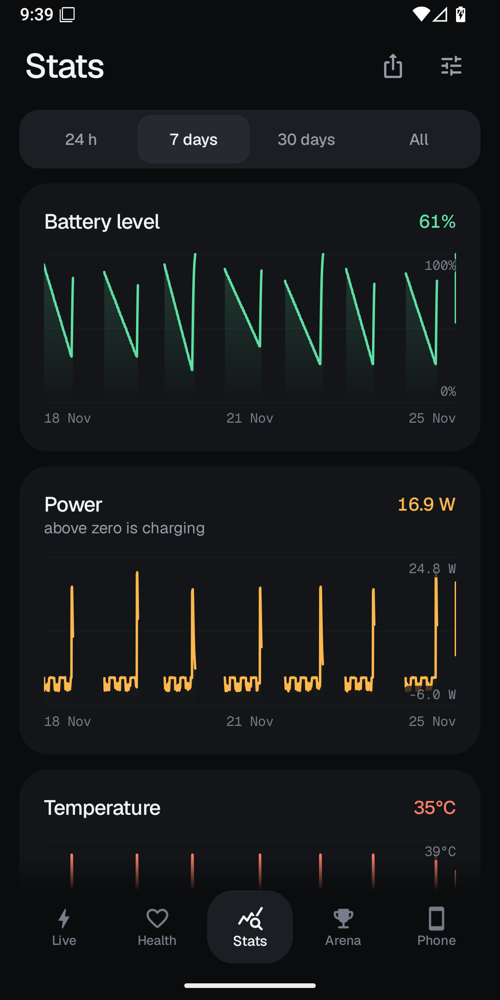

# Ampere

What 100% is really worth: true battery capacity, live charging watts, time to full, records and ranks for Android 10+.

| | | | |
|---|---|---|---|
|  |  |  |  |

Screenshots use demo data.

- **Real capacity** next to the original figure, with the method and confidence shown
- **Live** volts, milliamps, watts, charger offer, heat and throttling
- **Time to full** at the present speed, learned from how your phone really charges
- **Recognises** 25,000+ phone models, with charging specs for 327
- **Records** for any stretch (0 to 100, 20 to 80, 40 to 100...), live splits, 18 ranks, 46 achievements, daily goals
- **Analytics**, graded sessions, PDF / CSV / picture export
- No ads, no accounts, no analytics, no internet permission in the standard build

Values a phone does not report are shown as a dash, never guessed. Everything is measured at the battery, not the wall.

Build, code map, leaderboard setup and Play Store steps: [SESSION.md](SESSION.md). Privacy: [PRIVACY.md](PRIVACY.md).
Type: Geist, SIL Open Font License ([licenses/Geist-OFL.txt](licenses/Geist-OFL.txt)).
